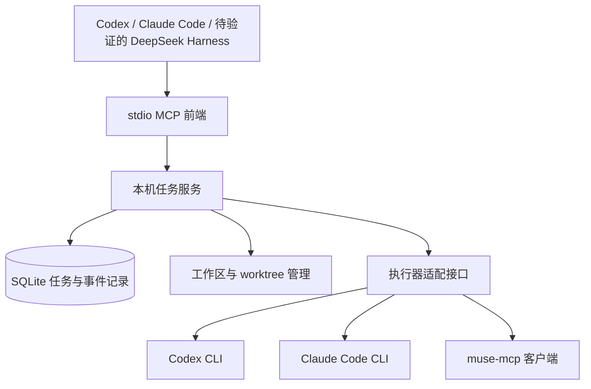

# 本地 Agent Hub 开发设计

日期：2026-10-09  
状态：2026-10-10 完成 Windows 第一版核心与验收收尾；最终范围和证据见 `../../第一版验收.md`，Mac / DeepSeek Harness 等保留后续验收。

开发前探针已完成，见 `../../2026-10-09-preflight-results.md`：Codex/Claude 原生续接、Muse 独立会话、Windows 合成进程取消和 worktree 均有实际证据。当前 Claude 经 CCR 使用 API 模式；Claude 订阅、Mac、DeepSeek Harness、Muse 远端取消尚未验收。

## 1. 目标与已确认流程

用户在 Codex 工作区发布任务，总控通过 MCP 提交给 Hub；Hub 调用本机真实执行器，并保存任务进度、回答及产物。以后可在 Claude Code 或 DeepSeek Harness 中挂载相同接口。切换总控不自动迁移原聊天历史；共享的是 Hub 的任务记录和明确传递的上下文。

用户于本次对话确认：

- 第一版 Windows 和 Mac 各自独立运行；跨机器调度后续开发。
- Muse 也进入统一任务列表。
- 编码任务默认在独立 Git worktree 修改；返回差异供审阅。
- 先创建开发文档，再开发；具体流程拿不准时向用户确认。

验收目标是完成真实的“提交 → 查询 → 结果 → 追问”闭环，并证明取消、超时、断线和重启不会造成重复发送或虚假的成功状态。

## 2. 范围与方案选择

选择 Python 本地任务服务 + SQLite + stdio MCP 前端。相比把任务生命周期绑定在一次 MCP 调用中，独立后台服务可让总控断开后任务继续，并保存任务状态。相比引入网络协作平台，本地方案优先实现已有需求，减少额外服务。

第一版提供 Codex、Claude Code、Muse 三个适配器，支持发现与诊断；某个执行器没有安装、登录或测试通过时如实标为不可用，不伪装兼容。DeepSeek Harness 的总控与执行器接入属于后续独立验收项，只有核对实际安装版本的 CLI/MCP 能力后才实现；不把 DeepSeek 模型 API 等同于 Harness。

第一版不包含：跨机器任务传输、多用户权限体系、公开 HTTP 服务、网页看板、自动选择模型、自动换供应商重试、自动提交或合并代码、自动发布。

现有 muse-mcp 保留原位置及配置；不改写其历史验收记录，不把其旧记录当作当前全系统测试结果。

## 3. 架构



MCP 前端处理短请求；后台任务服务负责队列、执行器进程、期限、取消及事件落盘。前端退出不终止后台任务。每个 OS 用户仅启动一个 Hub 服务，同一数据库不由多个服务竞争执行。

本机通信使用回环地址和用户私有令牌；不监听外部网卡。前端仅按用户级配置读取连接信息。后台进程自动启动但不安装系统服务；提供显式停止入口。

Python 基线为 3.10，Windows 使用项目独立虚拟环境及现有 py310 解释器。Mac 使用相同源码及独立环境。MCP SDK 与 CLI 版本在实现阶段核验并固定；此文档不声称已有跨平台实测。

## 4. 正常任务流程

1. 总控调用 `list_agents`，获取已配置执行器及最近诊断结果。
2. 总控明确指定执行器、任务、工作目录和模式，调用 `submit_task`。
3. Hub 校验路径、执行器能力和任务幂等键；编码任务创建独立 worktree。提交只入队，不等待执行器回答。
4. Hub 返回任务 ID；后台按并发额度启动任务。默认全局最多两个运行任务，每个执行器最多一个；可配置。
5. 总控通过 `get_task` / `get_events` 查看状态与增量进度。
6. 终态后 `get_result` 返回回答、异常、退出码、产物及工作区信息。回答与真实执行结果分别展示，不把模型的“完成了”作为验收证明。
7. 用户审阅差异后再决定如何集成。Hub 不自动合并或删除未集成 worktree。
8. `continue_task` 创建关联的新任务并复用原工作区；避免同一工作区同时执行两轮修改。

## 5. MCP 接口契约

| 工具 | 必需参数 | 可选参数 | 返回行为 |
|---|---|---|---|
| `list_agents` | 无 | 无 | 类型、安装/认证诊断、平台、能力和版本；诊断本身不发送模型任务 |
| `submit_task` | `request_id`, `agent`, `prompt`, `cwd`, `mode` | `timeout_seconds` | 立即返回任务字段 `id` 与当前状态；后续以该值作为 task_id；同一请求键及内容返回原任务，内容变化则冲突 |
| `get_task` | `task_id` | 无 | 状态、时间、执行器、工作区与结果引用；进度和错误详情分别通过 get_events / get_result 读取 |
| `get_events` | `task_id` | `after_seq`, `limit` | 有序分页事件与下一游标；默认 50 条，上限 200 条 |
| `wait_for_task` | `task_id` | `after_seq=0`, `timeout_seconds=10` | 等待任一终态或单次 0–10 秒上限；返回状态、最多 200 条事件、next_seq、has_more、timed_out；不改变任务期限 |
| `get_result` | `task_id` | 无 | 未完成返回 `ready=false`；终态返回回答、错误和产物信息 |
| `continue_task` | `request_id`, `task_id`, `prompt` | `timeout_seconds` | 创建子任务；返回新的 ID；不覆盖旧结果 |
| `cancel_task` | `task_id` | `reason` | 幂等请求取消，返回本地状态和实际取消能力，不捏造远端已停止 |

`mode` 初版为 `read_only` 或 `edit_worktree`。默认期限 1800 秒，允许 10–7200 秒。总控等待超时与任务期限独立：工具断开不会自动重发任务或改变任务期限。

2026-10-10 用户确认新增第八个工具，详见 `2026-10-10-wait-for-task-addendum.md`；原七个工具保持行为及结构。MCP 等待使用异步入口，后台在锁外等待；最后收到的游标用于续接，响应丢失按 seq 去重。

工具错误返回稳定错误码，例如 `AGENT_UNAVAILABLE`、`AUTH_REQUIRED`、`INVALID_WORKSPACE`、`REQUEST_CONFLICT`、`WORKSPACE_BUSY`、`RESULT_PENDING`。不得把密钥、Cookie 或完整环境变量放进错误正文。

## 6. 任务状态与恢复

正常路径：`queued → running → succeeded / failed / timed_out / cancelled`。

取消运行任务时可经过 `cancelling`。异常退出后无法证明任务仍在运行则标为 `interrupted`，结果保留不确定性。Muse 发送后连接丢失、无法判断是否接受时标为 `delivery_unknown`；禁止自动再次发送。

SQLite 保存：任务 ID、请求键与内容摘要、父任务 ID、执行器、状态、原目录与实际工作区、会话关联、期限、时间、错误；事件保存单调递增序号。回答和日志保存在用户私有数据目录，SQLite 保存引用。数据目录可配置，默认放在用户目录下的 `.agent-hub`，不放进源码仓库。

后台服务重启后：未开始的队列任务可继续；运行中的本地 CLI 任务先尝试核对进程身份，无法安全确认时标为 interrupted，不按旧 PID 直接终止进程。服务重启不等同于恢复执行。恢复 CLI 会话必须通过适配器支持的真实 session ID；否则明确使用历史摘要重建，不声称原生续跑。

## 7. 执行器行为

### Codex / Claude Code

适配器使用真实可执行路径和参数数组，不拼接 shell 命令。启动前诊断缺失可执行文件和凭证；认证有效性只有真实调用才能确认。

使用 CLI 自身认证，Hub 不额外要求模型 API Key。继承环境采用最小允许列表，避免 Hub 或其他执行器的 API Key 意外覆盖订阅；用户明确配置 API 模式时才允许对应凭证进入对应执行器。

本机探针发现 Claude 现有认证为 CCR apiKeyHelper/API 模式。适配器须显式支持该既有模式；不得以其成功调用宣称 Claude 订阅登录通过。Codex 当前 ChatGPT 登录与原生续接已验证；Claude 原生 session_id 续接也已验证。

从结构化输出提取最终回答、会话 ID、工具活动及退出状态；保存完整日志供本机排查。CLI 参数随版本变化，需要在实现时检查当前 `--help`，不照抄过时命令。

执行器不继承 Hub 自身 MCP 配置来递归分发任务；通过执行器专用配置限制递归，同时保留明确允许的工具。只读模式无法可靠约束的执行器必须拒绝该模式，不能只靠提示词声称只读。

### Muse

Hub 作为 MCP 客户端调用现有 muse-mcp。收到网关接受回复仅代表已发送，任务仍 running；后续读取 Muse 历史，基于会话标识、发送前序号和消息关联识别真实结果。

每个任务优先分配独立 Muse 会话；若连接器不支持创建独立会话，则采用专用会话串行执行并明确限制。模糊的回复不能判定为当前任务结果。不能使用简单字符串“完成”匹配。

本机已通过 muse_raw 的 session.start 创建独立会话；实现采用每任务独立会话并串行追问。raw 只在适配器内部按路由白名单使用。实测回复 reply_to_message_id 为空，必须使用会话与序号等证据关联，不依赖不存在的强关联字段。

Muse 的远端取消能力需实测。如果只有停止本地等待的能力，`cancel_task` 返回 `remote_cancelled=false`，说明 Muse 可能继续运行。超时同样不代表远端执行已停止。Muse 初版用于文本调研，不直接修改本地代码；可返回资料链接。

## 8. 工作区与产物

编码任务只接受存在的 Git 仓库且已提交至少一个基线提交。当前实现从 HEAD 已提交基线创建独立 worktree；已跟踪文件有未提交修改时返回 DIRTY_WORKSPACE。允许未跟踪文件留在主目录，不复制到 worktree，状态及产物记录 excluded_untracked_files。需要这些文件参与任务时先提交明确基线。

开发前顶层目录不是 Git 仓库；实现时已建立 Hub 自身仓库并创建独立开发 worktree。现有 Muse 克隆、`.tools`、日志与认证数据保持排除。测试任务使用专用 Git 测试仓库，不修改现有项目作为验收素材。

每个编码任务返回工作区绝对路径、基线 ref、变更文件、diff 获取位置和验证命令结果。Git worktree 隔离文件变更但不是安全沙箱；本机全局资源仍可能被 CLI 访问。

分析任务可使用现有目录。非 Git 目录可只读调研；不自动初始化用户指定目录。worktree 删除必须在任务结束后独立执行，且检查所有未保存变化；第一版不自动清理工作区。

## 9. 文件模块划分

已实现的主要模块目录：

```text
src/agent_hub/
  mcp_server.py       MCP 接口
  daemon.py           生命周期与本机通信
  service.py          队列、调度和工具业务逻辑
  store.py            SQLite 事务、幂等和事件
  models.py           任务/结果/能力结构
  workspaces.py       Git 基线与 worktree
  processes.py        平台进程管理与取消
  adapters/
    base.py           执行器协议
    codex.py          Codex CLI
    claude.py         Claude Code
    muse.py           muse-mcp 客户端
tests/               模拟执行器、Git 临时仓库、MCP 集成测试
docs/                设计、开发计划、部署与验收记录
```

## 10. 开发阶段与验收

1. 任务服务核心：SQLite、幂等、队列、状态、事件、结果、期限及模拟执行器；验证重复提交只执行一次，前端断开任务继续，结果可再次读取。
2. CLI 与工作区：Codex 真实只读及编辑闭环，再验证 Claude；测试子进程树取消、超时、无残留和同目录串行。验证主目录未被修改。
3. Muse：提交真实调研，区分接收确认与最终结果；验证关联、重复提交、未知发送状态和不能远端取消的反馈。
4. 总控与平台：注册 Codex MCP 后模型实际调用，再验证 Claude 总控。Mac 在实际设备执行同一验收；没有设备时只报告 Windows 已验收，Mac 待验收。
5. 后续：DeepSeek Harness 双向适配、跨机器调度和可选看板，各自另建验收范围。

必要测试包括：路径含空格与中文、Windows 可执行路径/代理、非 Git 与脏工作区、重复 request_id、同时追问、进程退出/超时/取消、服务重启、Muse 无关联消息、网关接受后断线、认证过期、超长日志分页。

真实调用会消耗相应账号额度。测试采用短且可验证的任务；测试成功后不重复调用模型刷验证。输出明确区分模拟测试、真实 CLI、真实 Muse、总控模型调用及 Mac 实测。

## 11. 待实现前检查与确认边界

本设计不把尚未测试的能力当成保证。开发时遇到以下事项向用户确认：未提交更改如何作为任务输入、缺失账号需登录、安装新的大型运行时、需要全局改变 CLI 权限、需要公开端口、跨机器认证、将 diff 合并到用户主目录。

已经确认的正常步骤无需反复询问：创建项目代码和独立环境、模拟测试、专用测试仓库内的 worktree、既有账号的短调用验证。MCP 注册在实现阶段保留配置备份，只添加 Hub 条目。

设计获确认后已建立独立开发 worktree、虚拟环境和后台服务，并备份后新增 Codex MCP 条目；实施计划与实际验收记录分别保存，不用历史探针代替最新验证。
